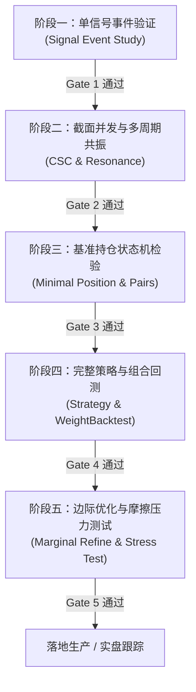

# CZSC Strategy Research Workflow (5-Stage Standard Quant Process)

## Overview

本技能固化了原作者（曾彬 / waditu）推荐的 CZSC 体系化量化研究工作流。
针对任何技术指标、K线形态、分型笔线段信号或交易逻辑，**禁止直接跳过前置验证进行全量暴力拟合**。完整的策略孵化必须严格遵守以下 5 个阶段与门禁标准：



标准可运行参考代码全集位于：`examples/ma_joint_study/`。

---

## 5-Stage Quant Research Workflow

### 阶段一：单信号事件验证（Signal Event Study）

**核心目的**：脱离具体交易规则，纯统计检验该信号在未来不同持有周期（$T+1 \sim T+N$）的前向收益分布，证明其具备统计显著的预测能力（Alpha），而非随机游走。

**核心步骤**：
1. **信号配置与解析**：
   使用 `czsc.get_signals_config` / `czsc.get_signals_freqs` 声明并生成信号时序（由 `czsc.generate_czsc_signals` 计算）。
2. **状态分布与持续性**：
   统计各信号取值的出现频率、持续 K 线根数（半衰期），确认信号触发密度合理（既非恒正常态，也非万分之一小样本）。
3. **事件驱动前向收益统计（Event Study）**：
   提取目标信号触发时刻点 $t$，计算前向持有 $k$ 根 K 线的收益率 $R_{t+k} = (Close_{t+k} - Close_t) / Close_t$：
   - 均值（Mean Return）
   - 中位数（Median Return）
   - 胜率（Win Rate: $P(R > 0)$）
   - 95% 置信区间：$\text{Mean} \pm 1.96 \times \frac{\text{Std}}{\sqrt{N}}$
4. **可视化输出**：
   输出胜率与置信区间条形图/折线图（如自包含 HTML 报告）。

**🚪 门禁标准（Gate 1）**：
- [ ] 样本触发事件数 $N \ge 30$（满足中心极限定理最低样本要求）；
- [ ] 最佳持有周期胜率 $> 50\%$（推荐 $> 52\%$）；
- [ ] 95% 置信区间下界大于 0（在 5% 显著性水平下拒绝“无预测能力”原假设）；
- [ ] 参考实现：`examples/ma_joint_study/01_signal_validation.py`。

---

### 阶段二：截面并发与多周期共振（Event CSC & Multi-timeframe Resonance）

**核心目的**：
1. 将单信号封装为 `Event` 逻辑表达式（`signals_all` / `signals_any` / `signals_not`）；
2. 检验横截面并发度（Cross-Sectional Concurrency, CSC），防止信号在市场普涨/系统性暴跌时发生拥挤并发；
3. 引入多时间周期联立（如大级别趋势顺势 + 本级别回调粘合发散），检验多周期共振能否有效提升胜率与盈亏分布。

**核心步骤**：
1. **Event 封装**：
   - 基线 Event A（如单级别形态）
   - 共振 Event B（如大级别顺势 + 小级别形态）
2. **多资产横截面扫描**：
   在多资产池（如 510500、000852、159915 等宽基/行业池）上运行信号生成，对齐同一时间戳计算并发率：
   $$\text{Concurrency}(t) = \sum_{i=1}^M \mathbb{I}(\text{Event triggered on symbol } i \text{ at } t)$$
3. **共振对比检验**：
   对比 Event A 与 Event B 在触发次数、前向 10 根 K 线收益均值及胜率的变化，确认大级别过滤是否带来了真实的胜率增益。

**🚪 门禁标准（Gate 2）**：
- [ ] 截面并发无极端聚集（同一时刻全市场集中开仓的事件占比处于合理范围）；
- [ ] 多级别共振 Event B 相比基线 A 胜率提升或平均收益显著改善，且未导致触发次数缩水至不可统计水平；
- [ ] 参考实现：`examples/ma_joint_study/02_event_csc.py`。

---

### 阶段三：基准持仓状态机检验（Minimal Position Baseline & Pairs Analysis）

**核心目的**：在接入复杂策略调度前，建立**最小持仓状态机**，脱离资金管理与多仓位耦合，纯粹检验单对开平仓逻辑的点对（Pairs）质量与安全边际。

**核心步骤**：
1. **构建最小 Position 结构**：
   - 固定基础持有时间步长：`interval: 4h`（或根据分析级别设定）
   - 单一进场事件：`opens = [Event(name="开多", ...)]`
   - 规则退出兜底：`timeout`（如 25d）与 `stop_loss`（如 300BP = 3%）
   - 单一出场事件：`exits = [Event(name="平多", ...)]`
2. **运行回测并提取交易对（Pairs）**：
   使用 `czsc.Position` 配合 `CzscStrategyBase.backtest()` 运行单资产测试，获取所有闭环交易列表（`pairs`）。
3. **计算四大核心指标**：
   - 实际胜率：$W = \frac{N_{\text{win}}}{N_{\text{total}}}$
   - 盈亏比：$R = \frac{\overline{\text{Gain}}}{\left|\overline{\text{Loss}}\right|}$
   - 盈亏平衡胜率（Break-even Win Rate）：$W_{\text{be}} = \frac{1}{1 + R}$
   - **安全边际（Safety Margin）**：$\Delta W = W - W_{\text{be}}$

**🚪 门禁标准（Gate 3）**：
- [ ] 闭环交易总笔数 $\ge 30$ 笔（历史跨度 $\ge 3$ 年）；
- [ ] 盈亏比 $R > 1.5$；
- [ ] **安全边际 $\Delta W > +10\%$**（确保在未来市场行情摩擦及胜率衰减下策略仍有正期望）；
- [ ] 异常交易检查：单笔最大亏损受 `stop_loss` 严格约束，无穿仓异常；
- [ ] 参考实现：`examples/ma_joint_study/03_position_baseline.py`。

---

### 阶段四：完整策略与组合回测（Strategy & WeightBacktest）

**核心目的**：将验证通过的 `Position` 封装为标准化 `CzscStrategyBase` 类，通过 `WeightBacktest` 运行多资产组合回测，产出生产级回测指标与可视化交互报告。

**核心步骤**：
1. **策略基类封装**：
   继承 `CzscStrategyBase`，实现：
   - `create_symbols_config()`：配置多标的资产池；
   - `init_czsc_strategy()`：配置多级别 K 线周期、`signals` 列表及 `positions` 列表；
   - 验证策略序列化/反序列化（`to_json` / `from_json`）。
2. **运行单品种与多品种回测**：
   - 单品种：`strat.backtest(bars, symbol)` 获取日度持仓权重；
   - 组合回测：多资产等权/风险平价配置，输入 `WeightBacktest(dfw, fee_rate=...)`；
3. **评估组合风险指标**：
   - 年化收益率（Annualized Return）
   - 年化波动率（Annualized Volatility）
   - 夏普比率（Sharpe Ratio）
   - 最大回撤（Max Drawdown）与卡玛比率（Calmar Ratio）
   - 资产间收益相关性矩阵（评估风险分散效应）
4. **生成交互报告**：
   调用 `wbt.generate_backtest_report(dfw, target_dir=...)` 输出自包含 HTML 报告。

**🚪 门禁标准（Gate 4）**：
- [ ] 单品种测试 Sharpe $\ge 0.5$；
- [ ] 多资产组合 Sharpe $\ge 1.0$，年化收益回撤比（Calmar）$\ge 1.0$；
- [ ] 多资产组合最大回撤明显低于单标的最大回撤（体现分散优势）；
- [ ] 产出交互式 HTML 报告及可复现的 `positions.json` 序列化文件；
- [ ] 参考实现：`examples/ma_joint_study/04_strategy_backtest.py`。

---

### 阶段五：边际优化与摩擦压力测试（Marginal Optimize & Friction Stress Test）

**核心目的**：
1. **边际调整**：严禁推倒重来，只做增量式的 `opens` 过滤器优化或 `exits` 止盈优化；
2. **参数敏感性**：检验止损点、超时等核心参数是否处于宽阔的平原（高原特征），而非孤立尖峰（过拟合特征）；
3. **摩擦压力测试**：测试 0 BP、2 BP、5 BP、10 BP 不同滑点与佣金下的收益衰减情况。

**核心步骤**：
1. **入场边际优化（Opens Marginal Test）**：
   在基准进场条件上，**每次仅增加一个**完全分类的过滤条件（如均线多头排列、波动率过滤），对比净收益与 Sharpe 变化。
2. **出场边际优化（Exits Marginal Test）**：
   在基准硬止损/超时基础上，引入动态跟踪止盈或结构破坏信号，观察回撤抑制效果。
3. **止损敏感性扰动（Stop Loss Sweep）**：
   扫描止损参数（如 1.5%、2.0%、3.0%、4.0%、5.0%），绘制 Sharpe 响应曲线，选择容错性最强的平原区间。
4. **摩擦衰减压力测试（Friction Stress Test）**：
   测试费用递增阶梯（0 BP $\to$ 2 BP $\to$ 5 BP $\to$ 10 BP），计算收益衰减率：
   $$\text{Decay Rate} = \frac{\text{Sharpe}_{10\text{BP}}}{\text{Sharpe}_{0\text{BP}}}$$

**🚪 门禁标准（Gate 5）**：
- [ ] 边际添加的条件必须具有明确的金融逻辑，拒绝单纯为拟合而加的复杂条件；
- [ ] 止损响应曲线具备宽平原特征，无参数断崖；
- [ ] **高摩擦测试（如 10 BP）下策略仍保持盈利**（年化收益 $> 0$），Sharpe 衰减幅度不超过 60%；
- [ ] 参考实现：`examples/ma_joint_study/05_marginal_optimize.py`。

---

## 策略研究决策树

```text
收到策略研发 / 信号验证任务
  │
  ├─> 是否是全新信号逻辑？
  │     ├─> 是 ──> 遵循 czsc-write-signal-function 编写 Rust 信号并通过测试
  │     └─> 否 ──> 从 czsc signals list / signal-functions 中选择已有信号
  │
  ├─> 阶段一：单信号验证 (Event Study)
  │     ├─> Gate 1 未过 (胜率 <= 50% 或 CI 包含 0) ──> 放弃或修正信号底层数学逻辑，不进回测
  │     └─> Gate 1 通过 ──> 进入阶段二
  │
  ├─> 阶段二：截面共振 (CSC)
  │     ├─> 确认跨标的并发度受控，多周期联立具有明确增益 ──> 进入阶段三
  │     └─> 共振效果差 / 样本急剧枯竭 ──> 调整周期或共振规则
  │
  ├─> 阶段三：基准持仓状态机 (Position Baseline)
  │     ├─> 构造 interval + timeout + stop_loss 最小状态机
  │     ├─> 计算安全边际: ΔW = W - 1/(1+R)
  │     ├─> Gate 3 未过 (ΔW < 10% 或 笔数 < 30) ──> 检查止损与超时设置，重新审视出场规则
  │     └─> Gate 3 通过 ──> 进入阶段四
  │
  ├─> 阶段四：组合回测 (Strategy & WeightBacktest)
  │     ├─> 封装 CzscStrategyBase，生成多资产单品种权重
  │     ├─> 运行 WeightBacktest 生成独立 HTML 报告
  │     └─> 组合 Sharpe >= 1.0 且回撤可控 ──> 进入阶段五
  │
  ├─> 阶段五：边际优化与摩擦测试 (Marginal Refine & Stress)
  │     ├─> 每次仅扰动/添加单一要素
  │     ├─> 10 BP 高滑点测试保持正收益
  │     └─> 全部通过 ──> 固化为稳定版本，产出完整投研结项报告
```

---

## Guardrails（红线与硬约束）

1. **绝对禁止跳步**：不得跳过阶段一（单信号统计）和阶段三（最小持仓安全边际），直接用阶段四的 `WeightBacktest` 拼凑参数。
2. **遵守开发宪法第一条**：涉及底层指标和信号计算统一由 Rust `_native` 执行，Python 保持纯透传。
3. **真实摩擦假设**：任何回测与优化必须明确声明交易成本（佣金、印花税、滑点），严禁报告 0 摩擦下的“虚高”绩效。
4. **可复现性（Reproducibility）**：所有实验产物必须落盘（代码脚本、序列化 JSON、HTML 报告、行情缓存），保证随时可用单行命令 byte-for-byte 复现。
