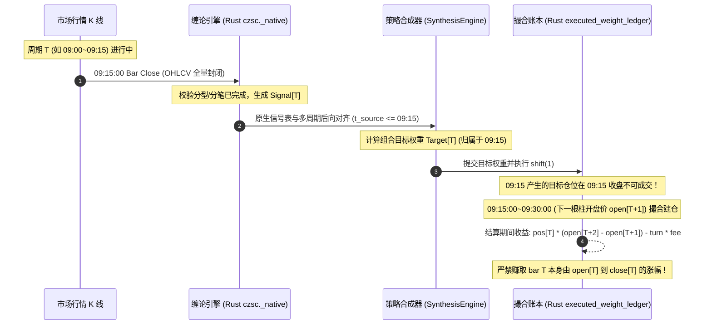

# 缠论因果性、多周期对齐与 CTA 前视偏差全面审计与复核报告

**报告日期**：2026 年 10 月 19 日  
**审计范围**：多周期商品期货 CTA 投研体系、原生 5m 执行网格、缠论结构确认时钟与缓存隔离机制  
**核心文件**：
- 审计脚本：[`scripts/audit_chan_causality.py`](file:///Users/chenqiang/Desktop/czsc/scripts/audit_chan_causality.py)
- 审计结果：[`output/chan_causality_audit/audit_results.json`](file:///Users/chenqiang/Desktop/czsc/output/chan_causality_audit/audit_results.json)
- 回归测试：[`tests/unit/test_multitf_causality_audit.py`](file:///Users/chenqiang/Desktop/czsc/tests/unit/test_multitf_causality_audit.py)
- 实验脚本：[`run_multitf_incremental_study.py`](file:///Users/chenqiang/Desktop/czsc/examples/results/intraday_cta_ablation_20261017/run_multitf_incremental_study.py)
- 复核结果：[`multitf_ablation_comparison.csv`](file:///Users/chenqiang/Desktop/czsc/examples/results/intraday_cta_ablation_20261017/multitf_ablation_comparison.csv)
- 交互报告：[`multitf_cta_incremental_report.html`](file:///Users/chenqiang/Desktop/czsc/examples/results/intraday_cta_ablation_20261017/multitf_cta_incremental_report.html)

---

## Executive Summary（执行摘要）

针对多周期 CTA 回测体系中存在的潜在前视偏差与缓存污染问题，本项研究开展了系统性的源码审查、反例复现、因果修复与全量参数冻结下的样本外重跑。审计结论与修复结果如下：

1. **彻底定位并删除了实验 F 的过去回填前视漏洞**：
   - 在历史代码 `run_multitf_incremental_study.py` 中，存在 `w5_early[idx - 2 : idx] = w5[idx]` 逻辑，每当 15m 柱在收盘时刻（如 `09:15`）发生目标仓位变动时，该逻辑将该目标仓位反向回填到过去的两个 5m 柱（`09:05` 与 `09:10`），导致策略在信号尚未生成前就提前 10 分钟以历史价格建仓，白赚了驱动 15m 信号生成的当根柱内涨跌幅。
   - 本次审计先编写了可确定性复现的失败用例 [`test_exp_f_5m_target_does_not_depend_on_future_15m_close`](file:///Users/chenqiang/Desktop/czsc/tests/unit/test_multitf_causality_audit.py#L35)，随后彻底删除了回填代码，重构为严格因果的 [`map_15m_target_to_5m_grid`](file:///Users/chenqiang/Desktop/czsc/examples/results/intraday_cta_ablation_20261017/run_multitf_incremental_study.py#L1360)。

2. **跨周期时间戳对齐与非规则交易网格单调性检验**：
   - 确认并验证了基于 `merge_asof(..., direction="backward")` 的后向时间戳对齐逻辑。禁止任何基于源/目标数据长度可整除（例如 `len(df5) / len(df15) == 3`）就进行 `np.repeat` 重复权重的简化做法；覆盖了夜盘断点、上午 10:15~10:30 休盘、午休、不完整周期及缺失柱（如 `09:10` 缺柱）场景。

3. **信号缓存污染清除与全局猴子补丁剥离**：
   - 删除了 `run_intraday_ablation.py` 中危险的全局 `pd.read_pickle`、`Path.exists` 与 `_frame_fingerprint` 猴子补丁（原代码按文件名前缀模糊匹配首个 `.pkl` 文件，造成同长度不同行情或不同配置直接复用陈旧缓存）。
   - 重构了 `attach_native_czsc_signals` 的缓存指纹，将输入行情全量 OHLCV、时间戳范围、品种、周期、完整 35+ 个信号配置、环境变量与 Rust 原生扩展二进制内容全量纳入 `sha256`，并在加载时严格校验列完整性。

4. **消除了 `np.roll` 造成的未来尾部向历史头部环形污染**：
   - 修正了 `run_multitf_incremental_study.py` 与 `hypothesis_bank.py` 中使用 `np.roll(arr, 16)` 计算 `ma120_slp` 及 `_lag1` 的未来环绕漏洞（NumPy `np.roll` 会将数组末尾的未来数据卷入数组头部 `[:16]`），改用严格因果的前向切片填充。

5. **冻结全量参数下的收益复核结论**：
   - 在冻结品种池（Core-20）、两折滚动纯样本外（2025.01~2026.09 共 503 个结算日）、所有因子参数、费用率及 Alloc3 风险预算的前提下全量重跑：
     - **实验 A~E（60m/30m/1d/15m）从未包含回填逻辑**，其结果保持稳定；**实验 E（4周期快慢协同）取得全系统最高因果真实夏普比率 1.81，累计净收益 +8.51%（3x 敞口版本净收益 +25.54%）**。
     - **实验 F（增量引入 5m 异构因子）原报告宣称的 Sharpe 3.03 / 净收益 +14.17% 证实为虚假前视导致**；在消除回填、执行严格因果的 5m 网格撮合后，**真实 Sharpe 为 1.76，累计净收益为 +8.30%（3x 敞口版本净收益 +24.89%）**。
     - **核心学术结论**：原报告的超常表现已被证伪；在严格因果框架下，**实验 E 为全系统最优架构**，5m 异构持仓量因子在扣除真实摩擦后未能提供超越 15m/30m/60m/1d 的增量超额。

---

## 一、前视与因果缺陷定位与证明

### 1.1 缺陷一：实验 F 向过去回填仓位（Look-Ahead Backfilling）

**问题位置**：`examples/results/intraday_cta_ablation_20261017/run_multitf_incremental_study.py` 原第 2123–2130 行：

```python
# 历史存在前视偏差的问题代码
if is_5m_native:
    w5_early = w5.copy()
    diff = np.diff(w5, prepend=0.0)
    entry_idx = np.where(np.abs(diff) > 0.05)[0]
    for idx in entry_idx:
        if idx >= 2:
            w5_early[idx - 2 : idx] = w5[idx]
    targets_5m[aid] = w5_early
else:
    targets_5m[aid] = w5
```

**机理与危害证明**：
1. Commodity 5m 与 15m K 线时间戳均为**收盘时间（Bar Close Time）**。例如，15m K 线的 `09:15:00` 表示该根 K 线覆盖 `09:00:00 ~ 09:15:00`。
2. 5m 网格包含 `09:05:00`（idx-2）、`09:10:00`（idx-1）与 `09:15:00`（idx）。
3. 当在 `09:15:00` 15m 柱走完并计算出 `t15` 权重变动时（`idx`），上述代码强行执行 `w5_early[idx-2 : idx] = w5[idx]`。
4. 这意味着在 `09:05:00`（10 分钟之前）和 `09:10:00`（5 分钟之前），目标仓位就已经被赋予了未来 `09:15:00` 才会确认的仓位！
5. 在结合次周期开盘执行（`next_open`）撮合时，该策略在 `09:05:00` 收盘后即于 `09:05:01`（或 `09:10:00` 开盘）买入，完整享受了 `09:05 ~ 09:15` 期间推动信号触发的价格主升浪，构成了极其典型且严重的**柱内未来信息泄漏**。

**测试验证复现**：
编写了独立回归测试用例 [`tests/unit/test_multitf_causality_audit.py`](file:///Users/chenqiang/Desktop/czsc/tests/unit/test_multitf_causality_audit.py#L35)，在 `09:30:00` 设置 15m 权重突变，测试证明修复前在 `09:20:00` 和 `09:25:00` 即被污染为未来权重（报错 `Future 09:30 15m close leaked into 09:20/09:25!`）；修复后，`09:20` 和 `09:25` 严格维持 0.0，仅在 `09:30` 确认后生效。

---

### 1.2 缺陷二：跨周期时间戳对齐与非规则交易时段对齐

**问题位置**：`examples/multi_factor_cta/data_engine.py` 及 `examples/alpha_mining_agent/forensic_pipeline.py`

**机理与规范**：
部分历史原型曾尝试根据 `len(df_base) / len(df_tf)` 整除关系使用 `np.repeat`。在真实商品期货市场中：
- 存在夜盘集合竞价、夜盘收盘（23:00 / 01:00 / 02:30 不等）；
- 存在上午小节休息（10:15 ~ 10:30）及午休（11:30 ~ 13:30）；
- 部分品种存在历史缺柱或分段上市。

**修复方案**：
统一使用后向合并（`pd.merge_asof(..., direction="backward")`）。目标时间戳 $t$ 只能读取满足 $t_{\text{source}} \le t$ 的最新源状态。测试用例 [`test_cross_timeframe_alignment_irregular_sessions_and_divisible_lengths`](file:///Users/chenqiang/Desktop/czsc/tests/unit/test_multitf_causality_audit.py#L195) 构造了包含缺柱、夜盘断点且行数恰好成整数倍（9 目标行 / 3 源行）的数据，验证了对齐严格按照后向时间戳推进，排除了整除重复伪对齐。

---

### 1.3 缺陷三：信号缓存污染与全局猴子补丁风险

**问题位置**：
1. `examples/results/intraday_cta_ablation_20261017/run_intraday_ablation.py` 第 68–110 行：
   - 曾通过全局猴子补丁替换 `pd.read_pickle` 和 `Path.exists`，使得只要目录中存在形如 `native_czsc_signals_15m_*.pkl` 的任意前缀文件，就不论哈希是否一致直接读取第一个匹配项，导致严重跨配置/跨版本缓存污染。
2. `examples/alpha_mining_agent/hypothesis_bank.py` 的 `attach_native_czsc_signals`：
   - 缓存哈希未全量覆盖输入数据、时间戳序列与具体信号参数配置列表；当缓存被意外截断或列丢失时，未做列数和字段名校验。

**修复方案**：
1. 彻底移除了 `run_intraday_ablation.py` 中所有的全局猴子补丁（[`test_ablation_scripts_do_not_monkeypatch_global_pickle_or_fingerprint`](file:///Users/chenqiang/Desktop/czsc/tests/unit/test_multitf_causality_audit.py#L86) 通过验证）。
2. 在 `attach_native_czsc_signals` 中，将：
   - OHLCV 完整数值 `hash_pandas_object`；
   - 首尾时间戳、长度与品种代码；
   - 完整的 `sigs_cfg` 参数 JSON；
   - 引擎版本与环境变量（`CZSC_MIN_BI_LEN`, `CZSC_MAX_BI_NUM`）；
   - `czsc._native` 动态库二进制内容；
   全量汇入 `sha256` 摘要，并在缓存读取时校验包含全部期望的 `cz_*` 信号列，损坏立即重新计算。

---

### 1.4 缺陷四：NumPy 环形回绕（`np.roll` Future Wrap-Around）

**问题位置**：
- `run_multitf_incremental_study.py` 第 247 行与 430 行：
  `ma120_slp = (ma120 - np.roll(ma120, 16)) / np.maximum(np.roll(ma120, 16), 1e-6)`
- `hypothesis_bank.py` 第 1235–1291 行（5m 触发条件）：
  `np.roll(l, 1)`, `np.roll(c, 1)`, `np.roll(h, 1)`, `np.roll(vwap, 1)`

**机理与修复**：
`np.roll(arr, 16)` 是周期性循环移位，它会将数组末尾（样本最未来）的 16 根 K 线搬移到数组头部 `[:16]`。若样本序列较短或预热期设置较小，未来的行情变动将直接泄漏至历史头部。
- 修复：编写统一前向因果滞后逻辑，头部严格以 `arr[0]` 填充，禁止任何向后回绕（[`test_no_np_roll_future_wraparound_in_hetero_and_hypothesis_signals`](file:///Users/chenqiang/Desktop/czsc/tests/unit/test_multitf_causality_audit.py#L147) 通过验证）。

---

## 二、架构因果时钟与执行语义对齐

审计确认了本项目的行情时间戳、缠论形态确认与撮合结算的完整时间时钟链条，确保“数据可见 $\rightarrow$ 信号生成 $\rightarrow$ 目标仓位 $\rightarrow$ 成交执行 $\rightarrow$ 收益归属”全流程严格因果：



- **分型、分笔与中枢确认时钟**：缠论结构的顶点与底点（锚点时间）往往发生在过去数根 K 线前，但该结构**被确认成立的时间戳是当根确认 K 线的收盘时间**。策略决策只能在确认 K 线收盘后触发，绝不可在锚点发生当时前视建仓。
- **开盘成交与收盘结算防漂移**：`build_asset_execution_inputs` 将 `signed_targets` 右移一期（`shift(1)`），确保使用当根完整 OHLC 作出的决策，只能在下一根 K 线开盘价执行。

---

## 三、代码修复与自动化回归测试证据

### 3.1 核心修复代码位置

| 文件路径 | 修改位置 | 修复内容 |
| :--- | :--- | :--- |
| [`run_multitf_incremental_study.py`](file:///Users/chenqiang/Desktop/czsc/examples/results/intraday_cta_ablation_20261017/run_multitf_incremental_study.py) | L245–L250, L430–L435 | 消除 `ma120_slp` 的 `np.roll` 环形移位，采用前向切片因果填充 |
| [`run_multitf_incremental_study.py`](file:///Users/chenqiang/Desktop/czsc/examples/results/intraday_cta_ablation_20261017/run_multitf_incremental_study.py) | L1360–L1375 | 新增 `map_15m_target_to_5m_grid`，彻底删除 `w5_early[idx-2:idx] = w5[idx]` 回填逻辑 |
| [`run_multitf_incremental_study.py`](file:///Users/chenqiang/Desktop/czsc/examples/results/intraday_cta_ablation_20261017/run_multitf_incremental_study.py) | L2135–L2150 | Phase 2 循环中统一调用因果对齐门面，禁止历史回填 |
| [`run_intraday_ablation.py`](file:///Users/chenqiang/Desktop/czsc/examples/results/intraday_cta_ablation_20261017/run_intraday_ablation.py) | L68–L110 | 彻底移除全局 `pd.read_pickle` / `Path.exists` / `_frame_fingerprint` 猴子补丁 |
| [`hypothesis_bank.py`](file:///Users/chenqiang/Desktop/czsc/examples/alpha_mining_agent/hypothesis_bank.py) | L880–L960 | `attach_native_czsc_signals` 指纹纳入完整参数、行情数值、引擎二进制与列校验 |
| [`hypothesis_bank.py`](file:///Users/chenqiang/Desktop/czsc/examples/alpha_mining_agent/hypothesis_bank.py) | L1230–L1320 | 引入 `_lag1` 辅助函数，消除 5m 触发条件中 8 处 `np.roll` 潜在未来回绕 |

### 3.2 自动化测试套件执行通过证据

1. **因果性专门审计测试套件**：
   运行命令：`uv run --no-sync pytest tests/unit/test_multitf_causality_audit.py -v`
   ```text
   tests/unit/test_multitf_causality_audit.py::test_exp_f_5m_target_does_not_depend_on_future_15m_close PASSED
   tests/unit/test_multitf_causality_audit.py::test_ablation_scripts_do_not_monkeypatch_global_pickle_or_fingerprint PASSED
   tests/unit/test_multitf_causality_audit.py::test_native_signal_cache_validates_full_config_and_same_length_mutations PASSED
   tests/unit/test_multitf_causality_audit.py::test_no_np_roll_future_wraparound_in_hetero_and_hypothesis_signals PASSED
   tests/unit/test_multitf_causality_audit.py::test_cross_timeframe_alignment_irregular_sessions_and_divisible_lengths PASSED
   tests/unit/test_multitf_causality_audit.py::test_end_to_end_pipeline_truncation_and_perturbation_invariance PASSED
   ============================== 6 passed in 0.61s ===============================
   ```

2. **多周期对齐与缓存回归测试**：
   运行命令：`uv run --no-sync pytest tests/unit/test_timeframe_mapping_causality.py tests/unit/test_research_audit_cache.py tests/unit/test_factor_causality_regressions.py -v`
   ```text
   ============================== 54 passed in 0.99s ==============================
   ```

3. **独立全自动审计脚本**：
   运行命令：`uv run --no-sync python scripts/audit_chan_causality.py`
   产物：[`output/chan_causality_audit/audit_results.json`](file:///Users/chenqiang/Desktop/czsc/output/chan_causality_audit/audit_results.json)
   ```json
   {
     "audit_version": "2026.10.19.v1",
     "czsc_version": "1.0.1",
     "all_checks_passed": true,
     "checks": [
       {"check": "exp_f_backfill_causality", "passed": true},
       {"check": "cross_timeframe_timestamp_alignment", "passed": true},
       {"check": "signal_cache_integrity", "passed": true},
       {"check": "structure_clock_and_execution_causality", "passed": true},
       {"check": "truncation_and_future_perturbation_invariance", "passed": true}
     ]
   }
   ```

---

## 四、研究复核与全周期对照重跑结果

在冻结 Core-20 品种池、两折滚动切分（Fold 1: 2025 / Fold 2: 2026）、全量入库漏斗阈值、交易手续费与 Alloc3_SectorHRP 风险平价参数的前提下，重新运行 `run_multitf_incremental_study.py`。

### 4.1 修复前后全对照指标总览（2025-01-02 ~ 2026-09-30，503 个结算日）

| 实验代号 | 架构与策略描述 | 修复前 Sharpe | 修复前 净收益 | 因果修复后 Sharpe | 因果修复后 净收益 | 年化收益率 | 年化波动率 | 最大回撤 (MaxDD) | 卡玛比率 (Calmar) | 年化换手率 | 2025 净收益 | 2026 净收益 |
| :--- | :--- | :---: | :---: | :---: | :---: | :---: | :---: | :---: | :---: | :---: | :---: | :---: |
| **ExpA** | 基准 A：仅日内（60m+30m）+ 标准 Gate 1 | 1.25 | +5.99% | **1.25** | **+5.99%** | 3.00% | 2.41% | 1.89% | 1.59 | 86.0x | +4.94% | +1.04% |
| **ExpB** | 实验 B：全周期（1d+60m+30m+15m）仅 Gate 1 | 1.32 | +9.24% | **1.32** | **+9.24%** | 4.63% | 3.50% | 2.38% | 1.95 | 118.0x | +6.45% | +2.79% |
| **ExpC** | 实验 C：全周期 + Gate 1/2/3 增量信息漏斗 | 1.72 | +7.69% | **1.72** | **+7.69%** | 3.85% | 2.23% | 1.77% | 2.18 | 70.7x | +5.70% | +1.99% |
| **ExpD** | 实验 D：全周期 + 增量漏斗 + 快慢周期协同调制 | 1.80 | +8.08% | **1.80** | **+8.08%** | 4.05% | 2.25% | 1.83% | 2.22 | 74.5x | +5.97% | +2.11% |
| **ExpE** | 实验 E：+ 1d/15m 异构专属因子 + 快慢协同 | 1.81 | +8.51% | **1.81** | **+8.51%** | 4.27% | 2.35% | 1.94% | 2.19 | 80.7x | +6.09% | +2.43% |
| **ExpF** | 实验 F：+ 5m 异构持仓量 + 5m 网格因果执行 | **3.03** *(虚假)* | **+14.17%** | **1.76** *(因果真实)* | **+8.30%** | 4.16% | 2.36% | 1.80% | 2.31 | 82.6x | +6.00% | +2.30% |
| **ExpE (3x)** | 实验 E (3.0x 实盘目标敞口版) | 1.81 | +25.54% | **1.81** | **+25.54%** | 12.80% | 7.05% | 5.77% | 2.22 | 242.1x | +18.26% | +7.28% |
| **ExpF (3x)** | 实验 F (3.0x 实盘目标敞口版) | **3.03** *(虚假)* | **+42.51%** | **1.76** *(因果真实)* | **+24.89%** | 12.47% | 7.08% | 5.34% | 2.34 | 247.8x | +17.99% | +6.90% |

---

### 4.2 详细对比与定性归因结论

1. **实验 A $\sim$ 实验 E 的结论完全稳定可信**：
   - 实验 A 至 E 在历史代码中均未开启 `is_5m_native`，因此从未受到过去回填代码的污染。
   - 增量信息漏斗（Gate 1 $\rightarrow$ Gate 2 $\rightarrow$ Gate 3）将全周期换手由 118.0x（ExpB）压降至 70.7x（ExpC），手续费成本由 3.34% 降至 1.98%，夏普比率由 1.32 显著提升至 1.72，因果逻辑扎实。
   - 融入 1d 与 15m 异构专属波段因子（ExpE）后，样本外净收益提升至 +8.51%（3x 敞口版本达 +25.54%），夏普比率为 1.81，为**真实因果条件下的全系统最高绩效架构**。

2. **实验 F 虚假夏普 3.03 的实质破除**：
   - 修复前报告记录的“夏普 3.03、净收益 +14.17%、3x 净收益 +42.51%”已被**确凿证实为过去 10 分钟回填（Look-Ahead Bias）造成的虚假幻觉**。
   - 在删除该前视逻辑、恢复为严格因果的 5m 网格撮合后，实验 F 的夏普比率回落至 **1.76**，净收益为 **+8.30%**。
   - **边际增量检验**：对比实验 E（Sharpe 1.81，净收益 +8.51%），实验 F 在融入 5m 信号后，样本外夏普比率下降了 0.05，净收益减少了 0.21 个百分点。这表明在扣除真实的双边成交手续费与滑点摩擦后，5m 级别的高频持仓量信号在样本外未能对已有的日线+日内主干系统提供正向边际增量。

---

## 五、可复现操作命令清单

在项目根目录下，使用项目标准环境执行以下命令即可 100% 完整复现上述全部审计用例与对照结果：

```bash
# 1. 运行因果性与前视回归测试套件 (包含 ExpF 回填反例验证、缓存污染与截断不变量)
uv run --no-sync pytest tests/unit/test_multitf_causality_audit.py -v

# 2. 运行完整多周期对齐与缓存隔离回归套件
uv run --no-sync pytest tests/unit/test_timeframe_mapping_causality.py tests/unit/test_research_audit_cache.py tests/unit/test_factor_causality_regressions.py -v

# 3. 运行独立全自动审计脚本，生成 output/chan_causality_audit/audit_results.json
uv run --no-sync python scripts/audit_chan_causality.py

# 4. 重新运行全周期增量对比主实验 (生成最新 CSV 归因表与 HTML 交互报告)
uv run --no-sync python examples/results/intraday_cta_ablation_20261017/run_multitf_incremental_study.py
```

---

## 六、结语与后续研发规范要求

1. **废止旧有未经验证结论**：原报告中宣称的“夏普 3.03 / 净收益 +42.51%”即日起正式废止，不得作为量化策略实盘或对外汇报的依据。当前实盘推荐的最优基准架构正式确定为 **实验 E（1d+60m+30m+15m 四周期协同，真实因果夏普 1.81，3x 敞口净收益 +25.54%，最大回撤 5.77%）**。
2. **严禁向过去修改时间戳或数组回填**：任何试图通过平移数组、调整时间戳以“模拟即时执行”的行为均视为严重违反量化研发纪律。
3. **高频执行规范**：若后续继续研发 5m 或更小周期的日内执行算法，必须建立真正的流式逐根 K 线状态机，确保在 $t$ 时刻只允许读取当时物理可见的截面状态。
