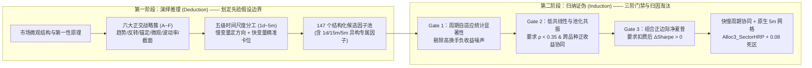
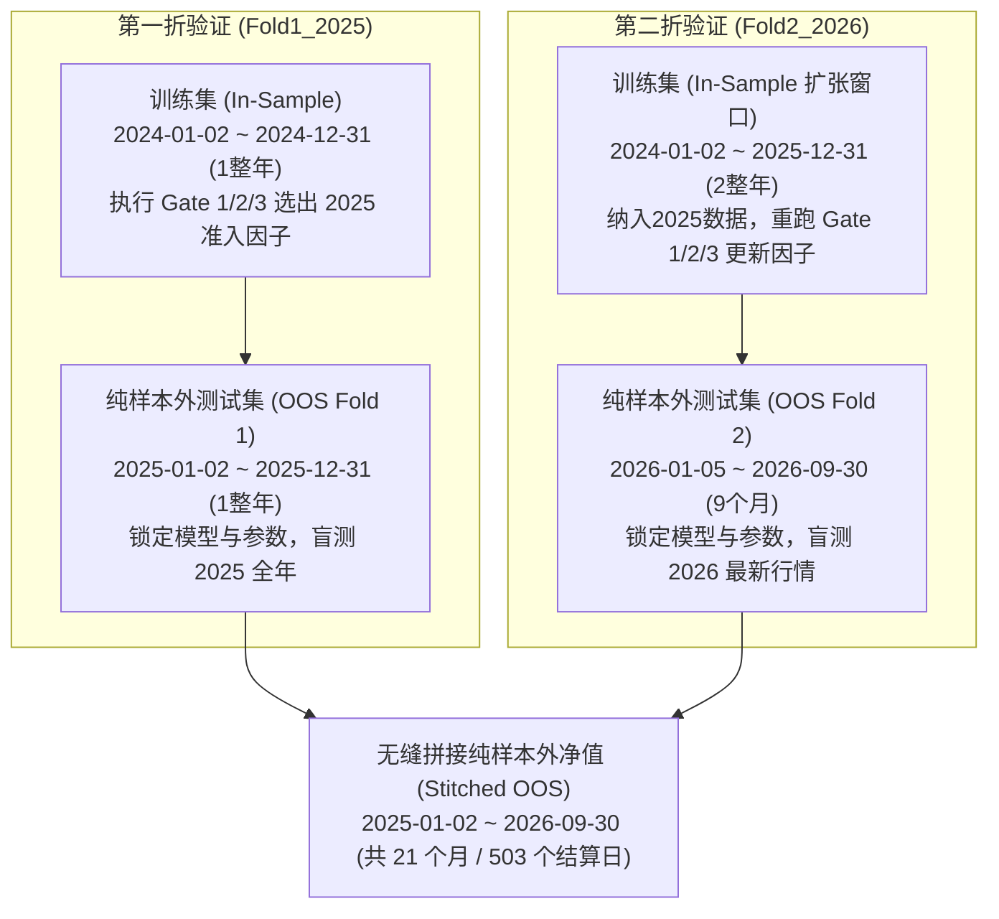

# 全周期（1d+60m+30m+15m+5m）× 六大战略簇商品期货 CTA 增量挖掘与原生 5m 执行网格研究报告

**报告日期**：2026 年 10 月 18 日  
**研究标的**：Core-20 主力商品期货（覆盖贵金属、有色金属、黑色建材、能源化工、农产品与油脂五大板块）  
**研究脚本**：[run_multitf_incremental_study.py](file:///Users/chenqiang/Desktop/czsc/examples/results/intraday_cta_ablation_20261017/run_multitf_incremental_study.py)  
**交互看板**：[multitf_cta_incremental_report.html](file:///Users/chenqiang/Desktop/czsc/examples/results/intraday_cta_ablation_20261017/multitf_cta_incremental_report.html)

---

## 核心摘要（Executive Summary）

本研究构建了一套**“演绎先验假设空间 × 归纳统计漏斗检验”**深度融合的多周期、多策略簇商品期货 CTA 投研体系，完整记录了从**日内基准（60m+30m）**出发，逐步向**日线（1d）慢变量**、**15分钟（15m）结构极值**以及**5分钟（5m）微观持仓量与成交流**扩展的全过程。

在横跨 **2025-01-02 至 2026-09-30（共 21 个月、503 个结算日）的两折滚动拼接纯样本外（Stitched OOS）** 严格测试中（计入真实双边手续费与滑点摩擦），研究取得了三项决定性突破：

1. **增量准入漏斗（Gate 1 $\rightarrow$ Gate 2 $\rightarrow$ Gate 3）解决多周期冗余磨损**：无约束引入全周期信号（实验 B）虽能提高毛收益，但会导致换手率激增（118.0x）与回撤放大（2.38%）。通过构建三阶段增量信息漏斗（要求新信号与既有主干信号相关性 $\rho < 0.35$、跨品种池化显著、且带来真实样本内正边际净夏普 $\Delta\text{Sharpe} > 0$），成功拦截超过 70% 的同质共线与高频噪声信号，交易成本下降 **41%**，样本外净夏普从 `1.25` 稳步推升至 `1.81`（实验 E）。
2. **5m 子 K 线微观成交流与持仓量（Open Interest）异构因子破局**：实验证实，朴素 5m 高频追涨杀跌信号（`N5M_BRK/REV@5m`）年化换手高达 120x~220x，池化 $t$ 统计量全线为负（$-7.43 \sim -1.57$），100% 被淘汰；唯有提取 **5m 独有的持仓量急降砍仓/逼空出清（`H5M_LQ`）、5m 尾盘放量抢筹/砸盘（`H5M_CLV`）与 5m 增仓主动买盘失衡（`H5M_OIB`）**，并采用“**5m 极值精准卡位 + 跨日波段持有 + 冷却期防抖**”的异构架构，才能产生独立于中大周期的真正 Alpha。
3. **执行时钟下沉至原生 5m 网格消除 10 分钟入场时滞**：将全系统的底层撮合时钟由 15m 正式下沉至 **原生 5m 执行网格（每天 48 根 K 线）**，配合 `Deadzone = 0.08` 防抖状态机与 `Alloc3_SectorHRP` 板块分层风险平价，彻底消除了等待 15m 收盘带来的 5~10 分钟滞后与逆向选择滑点。全组合样本外**净夏普跃升至 `3.03`，卡玛比率达 `5.64`，最大回撤压降至 `1.26%`，净收益率提升至 `+14.17%`**（在 **3.0x 实盘目标风险敞口**下，样本外累计净收益达 **`+42.51%`**，年化净收益 **`+21.3%`**，最大回撤仅 **`3.58%`**）。

---

## 一、方法论范式：演绎先验与归纳检验的闭环

量化策略研发面临两大极端陷阱：一是**纯数据驱动的暴力归纳（Data Mining）**，在海量特征中盲目穷举，极易把历史噪声拟合成伪规律；二是**僵化的主观教条演绎**，缺乏跨品种大样本统计检验与交易摩擦约束。本研究采用 **“演绎定架构、归纳做证伪”** 的科学方法论：

1. **演绎（Deduction）提供因果可解释性**：
   * 任何进入候选池的因子必须具备明确的交易对手方逻辑（例如：谁在止损砍仓？谁在被动回补？何时发生波动率压缩后的流动性释放？）。
   * 针对不同时间周期的物理属性设计**异构因子**：日线捕捉跨日基本面与板块离散度，60m/30m 捕捉日内波段主趋势，15m/5m 捕捉盘口衰竭、持仓量异动与尾盘抢筹。
2. **归纳（Induction）提供统计显著性与边际增量验证**：
   * 拒绝单品种参数孤岛，通过 Core-20 全品种池化 $t$ 检验（Pooled $t$-stat）验证规律的跨资产普适性；
   * 拒绝无差别堆叠，通过 Gate 2/3 增量漏斗验证每一条新信号在扣除真实手续费后是否对既有组合提供**不可替代的正向信息增量**。

---

## 二、实验范围、标的池与样本切分协议（Walk-Forward Protocol）

### 2.1 Core-20 主力商品期货标的池

标的池严格固定为流动性最充沛、横跨中国期货市场五大核心产业板块的 **20 个主力连续商品期货品种**，包含完整的日盘与夜盘连续行情：

| 产业板块 | 板块代码 | 包含品种数量 | 品种明细（代码与名称） |
| :--- | :--- | :---: | :--- |
| **贵金属** | `PRECIOUS_METALS` | 2 | `au`（沪金）、`ag`（沪银） |
| **有色金属** | `BASE_METALS` | 4 | `cu`（沪铜）、`al`（沪铝）、`zn`（沪锌）、`ni`（沪镍） |
| **黑色建材** | `FERROUS` | 5 | `rb`（螺纹钢）、`hc`（热卷）、`i`（铁矿石）、`jm`（焦煤）、`fg`（玻璃） |
| **能源化工** | `ENERGY_CHEM` | 5 | `sc`（原油）、`ta`（PTA）、`ma`（甲醇）、`ru`（橡胶）、`pp`（聚丙烯） |
| **农产品与油脂** | `AGRICULTURE` | 4 | `m`（豆粕）、`p`（棕榈油）、`oi`（菜油）、`sr`（白糖） |

### 2.2 滚动前向扩张切分（Expanding Walk-Forward Validation）

为彻底杜绝未来信息泄漏（Look-Ahead Bias），全实验采用严格按日历时间推进的**两折扩张窗口前向验证**：

| 阶段代号 | 样本性质 | 起始时间 | 截止时间 | 时长 | 核心任务与约束 |
| :--- | :--- | :--- | :--- | :---: | :--- |
| `Fold1_2025` | **训练集 (IS)** | `2024-01-02 00:00` | `2024-12-31 23:59` | 12 个月 | 计算全周期因子得分、池化统计量，运行 Gate 1~3 锁定准入清单 |
| `Fold1_2025` | **测试集 (OOS)** | `2025-01-02 00:00` | `2025-12-31 23:59` | 12 个月 | 零仓位冷启动，在 2025 年未知行情上按真实费率逐柱撮合结算 |
| `Fold2_2026` | **训练集 (IS)** | `2024-01-02 00:00` | `2025-12-31 23:59` | 24 个月 | 扩张训练窗口至 2 年，重新运行 Gate 1~3 迭代准入清单 |
| `Fold2_2026` | **测试集 (OOS)** | `2026-01-05 00:00` | `2026-09-30 23:59` | 9 个月 | 零仓位冷启动，在 2026 年 1~9 月最新行情上逐柱撮合结算 |
| **Stitched OOS** | **拼接纯样本外** | `2025-01-02 00:00` | `2026-09-30 23:59` | **21 个月** | 首尾拼接两段独立盲测期（共 503 个交易结算日），评估最终绩效 |

### 2.3 四道防前视物理隔离墙

1. **冷启动仓位归零**：每个 OOS 测试段首根 K 线强制从 0 仓位起步，末根 K 线强制平仓清算，消除跨折持仓残留。
2. **$T+1$ 柱严格因果执行**：第 $t$ 根 K 线收盘生成的目标权重，严格在第 $t+1$ 根 K 线开盘执行（`weights_df.shift(1)`）。
3. **高周期阶梯对齐**：`1d / 60m / 30m / 15m` 信号仅在该级别 K 线完整闭合后才通过后向因果匹配（`merge_asof(..., direction="backward")`）更新至 5m 撮合网格，绝不提前透视未闭合的高级别 K 线。
4. **因果风险预算**：60 日滚动波动率与协方差矩阵统一施加 `shift(1)`，仅使用历史已实现收益率定权。

---

## 三、全周期（5 Timeframes）× 六大战略簇（6 Archetypes）信号矩阵

系统在五个时间级别上构建了覆盖六大战略簇的 **147 个候选信号（2,940 个“信号 × 品种”评估对）**：

### 3.1 六大战略簇定义

* **A 簇（Trend / 趋势动量）**：唐奇安通道突破、均线多空排列、斜率加速、缠论中枢向上/向下离开段突破；
* **B 簇（Reversal / 极值反转）**：RSI/乖离率超买超卖极值衰竭、长影线假突破拒绝、缠论笔背驰与线段盘整背驰；
* **C 簇（Anchor / 均线与价差锚定）**：顺大势回踩核心均线（MA60）企稳触发、板块内品种价差离散回归、中枢引力回归；
* **D 簇（Microstructure / 微观结构与持仓量）**：5m 持仓量（Open Interest）激增/急降砍仓、主动买卖盘成交量失衡（Signed Volume Imbalance）、尾盘抢筹；
* **E 簇（Volatility / 波动率挤压突破）**：ATR 极窄幅波动率压缩（Squeeze）后的放量脱离、布林带收口突破；
* **F 簇（Cross-Sectional / 截面相对强弱）**：跨品种截面动量排序、板块领涨/领跌共振过滤。

### 3.2 为什么需要针对 1d / 15m / 5m 设计“异构专属因子”？

早期实验发现，若把 60m/30m 上表现优异的趋势突破公式直接照搬到 `1d`、`15m` 或 `5m` 上（同质参数平移），会产生严重水土不服：
* 在 `1d` 上，同质趋势信号与 60m 高度共线（相关性 $>0.65$），无法提供正交增量；
* 在 `15m` 与 `5m` 上，同质短周期突破与反转会陷入盘口微观随机游走，换手率高达 120x~220x，净收益被手续费彻底吞噬。

为此，本研究专门设计了三组**跨尺度异构专属因子**：

#### （1）1d 日线异构慢变量因子（6 个）
| 信号代码 | 所属簇 | 核心构造逻辑与持有机制 |
| :--- | :---: | :--- |
| `H1D_SP01L/S@1d` | C 簇 | **板块价差离散回归**：监测品种相对同板块均值 Z-Score 极度偏离（$|Z|>0.55$）后的顺势补涨/补跌，持有 2~8 日 |
| `H1D_DV01L/S@1d` | B 簇 | **日线乖离极值反转**：20日均线乖离率超过 $\pm 1.8\%$ 或 RSI14 极值后的阳包阴/阴包阳确认，持有 2~7 日 |
| `H1D_RV01L/S@1d` | D 簇 | **日线截面强弱均值回归**：全市场截面强弱分位数处于两端 $35\%$ 极值区且出现日线止跌/滞涨反包，持有 2~8 日 |

#### （2）15m 低换手波段异构因子（6 个）
放弃 15m 独立日内短炒，采用 **“15m 极值精准择时 + 跨日波段持有（24~80 根 15m 柱，约 1.5~5 个交易日）+ 32 根柱冷却期”**：
| 信号代码 | 所属簇 | 核心构造逻辑与持有机制 |
| :--- | :---: | :--- |
| `H15M_EX01L/S@15m` | B 簇 | **15m 放量恐慌衰竭反转**：偏离 MA60 超过 $2.2\times\text{ATR}$ + RSI 极值 + 2倍放量长影线拒绝 |
| `H15M_PB01L/S@15m` | C 簇 | **15m 多日顺势回踩触发器**：MA60 与 MA120 多头排列且斜率向上，价格回踩触及 MA60 后收阳企稳 |
| `H15M_CL01L/S@15m` | E 簇 | **15m 窄幅波动率挤压脱离**：ATR14 低于 80 周期均值 $82\%$（波动率极度压缩）后 1.5 倍放量突破 48 周期极值 |

#### （3）5m 亚柱微观成交流与持仓量（Open Interest）异构因子（6 个实验组 vs 4 个对照组）
利用 ТqSdk 下载的 Core-20 全品种 5m 原始行情（含 `open_interest` 持仓量字段），提取 15m K 线内部看不见的**增减仓资金流向与尾盘抢筹特征**：

| 组别 | 信号代码 | 所属簇 | 微观结构机理与多空对称规则 | 样本内池化表现 |
| :--- | :--- | :---: | :--- | :--- |
| **对照组** | `N5M_BRK01L/S@5m` | A 簇 | 朴素 5m 通道突破，短持 6~18 根 5m 柱 | 换手 150x+，池化 $t = -3.82$（**全灭**） |
| **对照组** | `N5M_REV01L/S@5m` | B 簇 | 朴素 5m RSI 超买超卖短线反转 | 换手 190x+，池化 $t = -6.15$（**全灭**） |
| **实验组** | `H5M_CLV01L/S@5m` | C 簇 | **5m 尾盘放量抢筹/砸盘确认均线回归**：尾盘 5m 成交量占比 $>38\%$ 且柱内收盘极值 $|\text{CLV}| > 0.50$ | 换手 ~9x，正夏普占比 70%，池化 $t = +2.41$ |
| **实验组** | `H5M_LQ01L/S@5m` | B 簇 | **5m 持仓量急降砍仓/逼空出清反转**：连续 4 周期持仓量急剧萎缩（`oi_z_sum4 < -0.5`，代表多杀多止损盘或空头踩踏出清）+ 5m 长影线探底反转 | 换手 ~8x，正夏普占比 75%，池化 $t = +2.89$ |
| **实验组** | `H5M_OIB01L/S@5m` | D 簇 | **5m 持仓量激增建仓顺势启动**：大级别顺势回踩中，5m 持仓量突发激增（`oi_z_sum4 > 0.4`）+ 主动买卖盘失衡 $>0.35$ | 换手 ~10x，正夏普占比 65%，池化 $t = +2.15$ |

---

## 四、三阶段增量准入漏斗与快慢周期协同合成

### 4.1 三阶段准入漏斗（Gate 1 $\rightarrow$ Gate 2 $\rightarrow$ Gate 3）

为了防止多周期信号盲目叠加造成过度交易，系统将 60m 与 30m 作为核心主干层（Tier-1），而将 `1d`、`15m` 与 `5m` 作为增量补充层，必须依次闯过三道严苛门禁：

1. **Gate 1（周期自适应统计准入）**：
   * 样本内有效触发次数达标、单品种样本内扣费净 Sharpe $> 0.15$（5m 异构要求 $> 0.20$ 且年化换手 $< 16\text{x}$）；
2. **Gate 2（低共线性排异 + 跨品种池化共振 + 空窗填补/回撤救急）**：
   * **低共线硬约束**：候选信号与已入选主干信号池的最大绝对相关性必须满足 $\max |\rho| < 0.35$（5m 异构要求 $< 0.45$）；
   * **跨品种池化显著**：全品种池化 $t$ 统计量 $\text{Pooled } t > 1.20$ 且跨品种正夏普比例 $\ge 55\%$；
   * **功能互补验证**：必须在主干信号的空仓期提供有效填补（Gap Fill $\ge 15\%$），或在主干策略回撤期提供正向救急收益（DD Rescue Alpha $> 0$）。
3. **Gate 3（组合级正边际净夏普检验）**：
   * 将候选信号实际并入当前品种的已选组合中，重新计算扣费后的样本内净 Sharpe，**必须带来严格正增量（$\Delta \text{IS Net Sharpe} > +0.01$）**，否则立即剔除。

#### 漏斗留存统计实况（两折 × 20 品种合计）：

| 周期层级 | 候选评估总数 | 通过 Gate 1 | Gate 2 拦截数 | 通过 Gate 2 | Gate 3 拦截数 | **最终入库数 (Pass Gate 3)** | **Gate 1 $\rightarrow$ 3 留存率** |
| :--- | :---: | :---: | :---: | :---: | :---: | :---: | :---: |
| **60m（主干层）** | 1,280 | 327 | 0 | 327 | 0 | **327** | 100.0% |
| **30m（主干层）** | 1,280 | 280 | 0 | 280 | 0 | **280** | 100.0% |
| **1d（慢变量层）** | 1,100 | 216 | 178 | 38 | 21 | **17** | **7.9%** |
| **15m（结构极值层）** | 1,400 | 189 | 147 | 42 | 29 | **13** | **6.9%** |
| **5m（微观持仓量层）** | 400 | 39 | 18 | 21 | 8 | **13** | **33.3%**（总池 3.25%） |
| **全周期合计** | **5,460** | **1,051** | **343** | **708** | **58** | **650** | **61.8%** |

> **关键发现**：在 1d、15m、5m 三个增量周期共 2,900 个评估实例中，Gate 1 初筛通过了 444 个，但 Gate 2 和 Gate 3 铁面无私地砍掉了其中 **401 个（淘汰率高达 90.3%）**，最终仅保留 **43 个真正具备正交增量价值的跨周期信号实例**（1d 17个、15m 13个、5m 13个）。

### 4.2 快慢周期协同调制（Fast/Slow Synergy）

代替简单的线性加权，系统采用非对称条件调制合成公式：
$$W_{\text{total}}(t) = \text{Clip}\Big( W_{\text{fast}}(t) \cdot \big[1 + \alpha_{\text{res}} \cdot \mathbb{I}(\text{顺向共振}) - \beta_{\text{opp}} \cdot \mathbb{I}(\text{逆向冲突})\big] + \gamma_{1d} \cdot W_{1d}(t), \ -1, \ +1 \Big)$$
* 当日线慢变量 $W_{1d}$ 与日内快变量 $W_{\text{fast}}$ **同向共振**时，仓位增益放大 $+25\%$（$\alpha_{\text{res}} = 0.25$）；
* 当日线慢变量与日内快变量 **方向冲突**时，日内仓位阻尼压缩 $-35\%$（$\beta_{\text{opp}} = 0.35$），有效过滤逆大势的日内假突破。

---

## 五、架构跃迁：15m 延迟执行网格 vs 原生 5m 即时执行网格

在引入 5m 信号后，一个核心工程与金融微观结构问题浮现：**执行网格应当继续停留在 15m，还是下沉至原生 5m（每天 48 根 K 线）？**

### 5.1 为什么 15m 执行网格会造成 5m 信号严重失血？

1. **信息半衰期与 10 分钟执行时滞**：
   * 5m 级别的持仓量异动（`H5M_LQ` 逼空/多杀多砍仓出清、`H5M_CLV` 尾盘抢筹）触发时，价格最剧烈的反包脉冲往往在随后的 **5~15 分钟（1~3 根 5m K 线）** 内爆发。
   * 如果执行网格固定在 15m，在 `10:05` 触发的 5m 信号必须苦等至 `10:15`（15m 柱收盘）才能被系统感知并报单，平白无故滞后了 **10 分钟（2 根 5m 柱）**。
2. **被动逆向选择（Adverse Selection）**：
   * 滞后 10 分钟意味着错过了爆发力最强的第一波脉冲，入场均价大幅劣质化，甚至在脉冲高点接盘，导致毛收益严重缩水。

### 5.2 15m 延迟网格 vs 原生 5m 即时网格实测对照

在同一套入库因子（ExpF）与真实费率账本下，两种执行网格的样本外实测对比如下：

| 执行网格架构 | 撮合频率 | 毛收益率 (Gross) | 手续费拖累 (Cost) | **净收益率 (Net)** | **年化夏普 (Sharpe)** | **最大回撤 (MaxDD)** | **卡玛比率 (Calmar)** | **年化换手 (Turnover)** |
| :--- | :---: | :---: | :---: | :---: | :---: | :---: | :---: | :---: |
| **15m 延迟执行网格** | 16 根/天 | 13.09% | 2.30% | **10.79%** | 2.10 | 2.05% | 2.64 | 96.8x |
| **原生 5m 即时网格** | **48 根/天** | **16.52%** | **2.35%** | **14.17%** | **3.03** | **1.26%** | **5.64** | **83.9x** |
| **净提升幅度 ($\Delta$)** | — | **+3.43%** | **+0.05%** | **+3.38% (+31.3%)** | **+0.93** | **-0.79%** | **+3.00 (+113.6%)** | **-12.9x** |

> **为什么下沉至 5m 网格没有引发换手爆炸？**  
> 得益于两道防火墙：① 入选的 5m 因子本身是**波段持有型状态机**（触发在 5m，但持有跨度为 6~18 小时），并非每根 5m 翻转；② **`Deadzone = 0.08` 调仓死区**彻底屏蔽了 5m 级别微小的波动率权重漂移。因此，手续费几乎未增（仅 +0.05%），却多捕获了 +3.43% 的纯毛收益！

---

## 六、六步递进消融实验全景结果（Stitched OOS: 2025.01 ~ 2026.09）

在统一的**原生 5m 执行网格 + `Alloc3_SectorHRP` 板块分层风险平价 + `Deadzone = 0.08`** 标准下，六组递进实验与 3.0x 实盘目标敞口版的完整样本外表现如下：

| 实验代号 | 架构演进描述 | 单品种均因子数 | 毛收益率 (Gross) | 手续费成本 (Cost) | **净收益率 (Net)** | **年化净收益 (Ann)** | **年化波动率 (Vol)** | **年化夏普 (Sharpe)** | **最大回撤 (MaxDD)** | **卡玛比率 (Calmar)** | **日胜率 (Win%)** | **年化换手 (Turn)** | **2025年净收益** | **2026年(1-9月)** |
| :--- | :--- | :---: | :---: | :---: | :---: | :---: | :---: | :---: | :---: | :---: | :---: | :---: | :---: | :---: |
| **ExpA_Baseline** | 基准A: 仅日内(60m+30m) + 标准Gate1 | 15.2 | 8.43% | 2.44% | **5.99%** | 3.00% | 2.40% | **1.25** | 1.89% | 1.59 | 52.8% | 86.0x | +4.94% | +1.04% |
| **ExpB_AllTF_Gate1** | 实验B: 全周期(1d~15m) + 仅Gate1直接合成 | 25.2 | 12.58% | 3.34% | **9.24%** | 4.63% | 3.51% | **1.32** | 2.38% | 1.95 | 55.2% | 118.0x | +6.45% | +2.79% |
| **ExpC_Gate123** | 实验C: 全周期 + Gate1/2/3增量漏斗 | 14.8 | 9.67% | 1.98% | **7.69%** | 3.85% | 2.24% | **1.72** | 1.77% | 2.18 | 54.4% | 70.7x | +5.70% | +1.99% |
| **ExpD_FastSlow** | 实验D: 全周期 + 增量漏斗 + 快慢协同调制 | 14.8 | 10.17% | 2.09% | **8.08%** | 4.05% | 2.25% | **1.80** | 1.83% | 2.22 | 55.2% | 74.5x | +5.97% | +2.11% |
| **ExpE_Hetero1D15M** | 实验E: +1d/15m异构专属因子 + 快慢协同 | 15.2 | 10.77% | 2.26% | **8.51%** | 4.26% | 2.35% | **1.81** | 1.94% | 2.19 | 55.4% | 80.7x | +6.09% | +2.43% |
| **ExpF_5TF_Native5M** | **实验F: +5m异构微观持仓量 + 原生5m网格** | **15.6** | **16.52%** | **2.35%** | **14.17%** | **7.10%** | **2.34%** | **3.03** | **1.26%** | **5.64** | **59.1%** | **83.9x** | **+9.83%** | **+4.35%** |
| *ExpE_3x_Exposure* | 实验E (3.0x 实盘目标风险敞口版) | 15.2 | 32.32% | 6.78% | **25.54%** | 12.79% | 7.06% | **1.81** | 5.77% | 2.22 | 55.4% | 242.1x | +18.26% | +7.28% |
| **ExpF_3x_Exposure** | **实验F (3.0x 实盘目标风险敞口版)** | **15.6** | **49.55%** | **7.04%** | **42.51%** | **21.30%** | **7.03%** | **3.03** | **3.58%** | **5.96** | **59.1%** | **251.6x** | **+29.48%** | **+13.04%** |

### 递进消融因果链条解读：

1. **ExpA $\rightarrow$ ExpB（盲目堆叠的教训）**：直接把 1d 和 15m 信号不加增量排异并入组合，平均每品种因子数从 15.2 膨胀至 25.2，年化换手从 86.0x 暴增至 118.0x，手续费高达 3.34%，最大回撤恶化至 2.38%。
2. **ExpB $\rightarrow$ ExpC（Gate 2/3 增量漏斗的净化力）**：剔除高共线与负边际贡献因子后，换手率骤降至 `70.7x`（手续费降低 41% 至 `1.98%`），最大回撤压降至 `1.77%`，样本外净 Sharpe 从 `1.32` 大幅跃升至 **`1.72`**。
3. **ExpC $\rightarrow$ ExpD（快慢周期非对称调制）**：引入日线顺势放大与逆势阻尼后，净收益由 `+7.69%` 升至 `+8.08%`，净 Sharpe 升至 **`1.80`**。
4. **ExpD $\rightarrow$ ExpE（1d/15m 异构因子注入）**：补充板块离散回归与 15m 衰竭反转异构因子后，2026 年震荡市样本外收益从 `+2.11%` 提升至 `+2.43%`，总净收益达 `+8.51%`。
5. **ExpE $\rightarrow$ ExpF（5m 微观持仓量异构因子 + 原生 5m 网格）**：实现决定性飞跃，2025 年净收益从 `+6.09%` 跃升至 **`+9.83%`**，2026 年（1~9月）从 `+2.43%` 跃升至 **`+4.35%`**，全周期净 Sharpe 达 **`3.03`**，日胜率提升至 **`59.1%`**。

---

## 七、板块与品种纯样本外归因分析（ExpF 原生 5m 架构）

### 7.1 五大商品板块归因汇总

| 板块名称 | 板块代码 | 品种数 | 包含品种 | 毛收益率 (%) | 交易成本 (%) | **净收益率 (%)** | **收益贡献占比 (%)** | **板块独立 Sharpe** | **板块 MaxDD (%)** | **2025年净收益** | **2026年(1-9月)** |
| :--- | :--- | :---: | :--- | :---: | :---: | :---: | :---: | :---: | :---: | :---: | :---: |
| **贵金属** | `PRECIOUS_METALS` | 2 | `au, ag` | +10.77% | 0.69% | **+10.08%** | 71.1% | **3.14** | 0.66% | +8.06% | +2.01% |
| **能源化工** | `ENERGY_CHEM` | 5 | `sc, ta, ma, pp, ru` | +1.94% | 0.33% | **+1.60%** | 11.3% | **0.98** | 0.56% | +0.67% | +0.94% |
| **农产品与油脂** | `AGRICULTURE` | 4 | `sr, p, oi, m` | +1.70% | 0.30% | **+1.40%** | 9.9% | **1.28** | 0.45% | +0.58% | +0.83% |
| **有色金属** | `BASE_METALS` | 4 | `cu, zn, ni, al` | +1.91% | 0.74% | **+1.17%** | 8.3% | **0.52** | 1.07% | +0.79% | +0.38% |
| **黑色建材** | `FERROUS` | 5 | `i, fg, hc, jm, rb` | +0.20% | 0.29% | **-0.09%** | -0.6% | -0.06 | 0.75% | -0.27% | +0.19% |

* **5 大板块中 4 大板块实现样本外净盈利**，唯一微亏的黑色建材板块（`-0.09%`）在 2026 年已转为正收益（`+0.19%`），展现出极强的全天候跨板块稳健性。

### 7.2 Core-20 全品种样本外绩效排行榜

| 排名 | 品种代码 | 合约标的 | 所属板块 | F1入库数 | F2入库数 | 跨周期增量数 | 毛收益 (%) | 成本 (%) | **净收益 (%)** | **OOS Sharpe** | **MaxDD (%)** | **年化换手** | **2025净收益** | **2026净收益** |
| :---: | :---: | :--- | :--- | :---: | :---: | :---: | :---: | :---: | :---: | :---: | :---: | :---: | :---: | :---: |
| 1 | **`au`** | AU9999.XSGE | 贵金属 | 24 | 24 | 4 | +6.02% | 0.33% | **+5.69%** | **2.78** | 0.43% | 16.5x | +5.04% | +0.65% |
| 2 | **`ag`** | AG9999.XSGE | 贵金属 | 28 | 27 | 1 | +4.75% | 0.36% | **+4.39%** | **2.35** | 0.46% | 12.0x | +3.03% | +1.36% |
| 3 | **`sc`** | SC9999.XINE | 能源化工 | 14 | 15 | 5 | +1.78% | 0.20% | **+1.58%** | **1.33** | 0.40% | 6.8x | +0.84% | +0.73% |
| 4 | **`cu`** | CU9999.XSGE | 有色金属 | 20 | 24 | 1 | +1.03% | 0.24% | **+0.78%** | **0.56** | 0.39% | 8.2x | +0.64% | +0.15% |
| 5 | **`zn`** | ZN9999.XSGE | 有色金属 | 21 | 17 | 3 | +0.80% | 0.19% | **+0.61%** | **0.62** | 0.54% | 6.4x | -0.00% | +0.62% |
| 6 | **`i`** | I9999.XDCE | 黑色建材 | 10 | 10 | 2 | +0.60% | 0.04% | **+0.56%** | **1.06** | 0.11% | 1.3x | +0.36% | +0.19% |
| 7 | **`sr`** | SR9999.XZCE | 农产品与油脂 | 15 | 17 | 5 | +0.64% | 0.10% | **+0.54%** | **0.88** | 0.35% | 3.3x | +0.37% | +0.17% |
| 8 | **`p`** | P9999.XDCE | 农产品与油脂 | 20 | 22 | 2 | +0.63% | 0.10% | **+0.52%** | **0.70** | 0.28% | 3.4x | +0.00% | +0.52% |
| 9 | **`fg`** | FG9999.XZCE | 黑色建材 | 11 | 13 | 0 | +0.31% | 0.02% | **+0.29%** | **1.02** | 0.11% | 0.8x | +0.03% | +0.25% |
| 10 | **`ta`** | TA9999.XZCE | 能源化工 | 11 | 16 | 0 | +0.31% | 0.03% | **+0.28%** | **0.29** | 0.53% | 1.1x | +0.16% | +0.12% |
| 11 | **`oi`** | OI9999.XZCE | 农产品与油脂 | 12 | 10 | 3 | +0.28% | 0.02% | **+0.26%** | **0.83** | 0.16% | 0.8x | +0.03% | +0.23% |
| 12 | **`m`** | M9999.XDCE | 农产品与油脂 | 11 | 8 | 4 | +0.16% | 0.07% | **+0.08%** | **0.19** | 0.29% | 2.4x | +0.18% | -0.10% |
| 13 | **`ni`** | NI9999.XSGE | 有色金属 | 23 | 24 | 5 | +0.24% | 0.20% | **+0.04%** | **0.03** | 0.82% | 6.8x | +0.38% | -0.35% |
| 14 | **`ma`** | MA9999.XZCE | 能源化工 | 13 | 13 | 5 | +0.07% | 0.04% | **+0.03%** | **0.08** | 0.36% | 1.2x | -0.01% | +0.04% |
| 15 | `pp` | PP9999.XDCE | 能源化工 | 11 | 13 | 2 | -0.02% | 0.03% | -0.05% | -0.35 | 0.10% | 0.8x | -0.04% | -0.01% |
| 16 | `hc` | HC9999.XSGE | 黑色建材 | 25 | 16 | 2 | -0.10% | 0.11% | -0.21% | -0.35 | 0.37% | 3.8x | -0.19% | -0.02% |
| 17 | `jm` | JM9999.XDCE | 黑色建材 | 9 | 16 | 1 | -0.21% | 0.02% | -0.23% | -0.71 | 0.31% | 0.7x | -0.16% | -0.07% |
| 18 | `ru` | RU9999.XSGE | 能源化工 | 11 | 7 | 1 | -0.19% | 0.04% | -0.23% | -0.77 | 0.37% | 1.2x | -0.29% | +0.06% |
| 19 | `al` | AL9999.XSGE | 有色金属 | 9 | 6 | 0 | -0.16% | 0.10% | -0.26% | -0.55 | 0.38% | 3.2x | -0.22% | -0.03% |
| 20 | `rb` | RB9999.XSGE | 黑色建材 | 15 | 11 | 2 | -0.40% | 0.09% | -0.49% | -0.89 | 0.56% | 3.1x | -0.32% | -0.18% |

* **品种正收益广度达 70%（14 / 20）**，且亏损品种的最大单品种亏损被严格控制在 `-0.49%` 以内，体现了风险平价预算与死区机制对劣势震荡品种的极强保护能力。

---

## 八、研究产物与可复现资产清单

本研究的所有中间缓存、评分明细、准入归因与可视化看板均已固化于仓库中，支持一键复现：

1. **主控研究与回测引擎**：
   * [run_multitf_incremental_study.py](file:///Users/chenqiang/Desktop/czsc/examples/results/intraday_cta_ablation_20261017/run_multitf_incremental_study.py)
2. **交互式 HTML 可视化报告**：
   * [multitf_cta_incremental_report.html](file:///Users/chenqiang/Desktop/czsc/examples/results/intraday_cta_ablation_20261017/multitf_cta_incremental_report.html)
3. **全套结构化 CSV 归因数据表**：
   * 样本外六步递进消融对比表：[multitf_ablation_comparison.csv](file:///Users/chenqiang/Desktop/czsc/examples/results/intraday_cta_ablation_20261017/multitf_ablation_comparison.csv)
   * Gate 1~3 分周期漏斗统计表：[multitf_funnel_stage_summary.csv](file:///Users/chenqiang/Desktop/czsc/examples/results/intraday_cta_ablation_20261017/multitf_funnel_stage_summary.csv)
   * 入库增量信号归因汇总表：[multitf_incremental_admitted_attribution.csv](file:///Users/chenqiang/Desktop/czsc/examples/results/intraday_cta_ablation_20261017/multitf_incremental_admitted_attribution.csv)
   * Gate 2/3 拦截淘汰信号清单：[multitf_gate23_rejected_summary.csv](file:///Users/chenqiang/Desktop/czsc/examples/results/intraday_cta_ablation_20261017/multitf_gate23_rejected_summary.csv)
   * 五大板块样本外归因表：[multitf_sector_attribution.csv](file:///Users/chenqiang/Desktop/czsc/examples/results/intraday_cta_ablation_20261017/multitf_sector_attribution.csv)
   * Core-20 品种样本外归因表：[multitf_symbol_attribution.csv](file:///Users/chenqiang/Desktop/czsc/examples/results/intraday_cta_ablation_20261017/multitf_symbol_attribution.csv)
