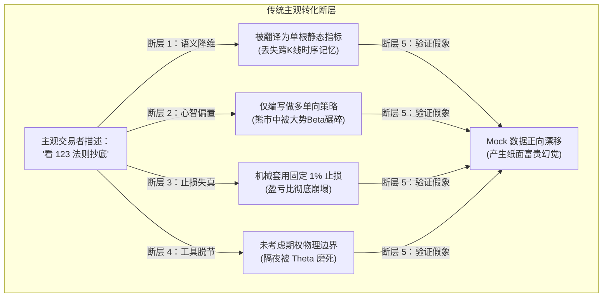
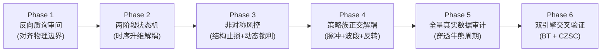

# 量化交易策略开发实战指南（Agent & Quant 标准 SOP）

> **版本**：v2.0 (2026-10 全量完善版)  
> **适用对象**：量化研究员、自动化策略开发 Agent、CTA/期权日内策略架构师  
> **核心宗旨**：拒绝单根 K 线的随机漫步预测，以「非对称赔率架构」与「两阶段状态机」构建具备全天候穿透力的正期望策略族。

---

## 目录
1. [策略设计第一性原理](#1-策略设计第一性原理)
2. [主观经验到策略族的转化工作流（重构 5 大断层）](#2-主观经验到策略族的转化工作流重构-5-大断层)
   - [2.1 传统工作流的 5 大致命断层剖析](#21-传统工作流的-5-大致命断层剖析)
   - [2.2 完善后的 6 阶段转化流水线 (SOP)](#22-完善后的-6-阶段转化流水线-sop)
   - [2.3 策略族的正交解耦矩阵 (2B + 123 + TD)](#23-策略族的正交解耦矩阵-2b--123--td)
   - [2.4 供后续 Agent 直接使用的系统提示词模板](#24-供后续-agent-直接使用的系统提示词模板)
3. [核心架构与代码实现模板](#3-核心架构与代码实现模板)
4. [法医级回测避坑指南 (5大陷阱)](#4-法医级回测避坑指南-5大陷阱)
5. [策略合格性验收指标卡](#5-策略合格性验收指标卡)
6. [跨品种与跨周期迁移法则](#6-跨品种与跨周期迁移法则)

---

## 1. 策略设计第一性原理

任何能够长期生存并实现复利的策略，底层必须建立在以下三项博弈论与数学公理之上：

### 1.1 非对称赔率公理 (Asymmetric Payoff)
- **数学本质**：期望收益 $E = (P \times W) - ((1 - P) \times L) - C$。
- **核心法则**：不要把精力耗费在追求 70%+ 的胜率幻觉上，重点是将**单笔盈亏比 $\frac{W}{L}$ 做到 $1.7 \sim 1.9$ 以上**。
- **实现手段**：
  - **亏损端截断**：止损锚定在微观结构破位点（仅亏损 0.2%~0.4%），决不扛单；
  - **盈利端奔跑**：让浮盈跟随日内趋势延伸，依靠动态追踪止盈（回撤 1.2%~1.5%）锁定成果。

### 1.2 两阶段状态机公理 (Two-Phase State Machine)
- 单根 K 线的指标金叉、死叉或超买超卖，本质是白噪声。
- 稳健系统必须解耦为两个独立时间序列阶段：
  $$\text{信号触发} = \text{阶段 1: Setup (势能蓄力/极值拉偏)} + \text{阶段 2: Confirmation (动能破局/微观确认)}$$

### 1.3 多空对称公理 (Symmetrical Invariance)
- 资产走势为 $\text{Beta (大势重力)} + \text{Alpha (微观动量)}$。
- 单向做多系统承担了 100% 的 Beta 下跌风险，熊市必然被绞杀。
- **规则必须在几何与状态上 100% 多空对称**。空头机制不仅是对冲，更是熊市超额收益的最大来源。

---

## 2. 主观经验到策略族的转化工作流（重构 5 大断层）

### 2.1 传统工作流的 5 大致命断层剖析

在传统的「主观经验形式化 $\rightarrow$ 信号组合 $\rightarrow$ 策略组装」工作流中，存在 5 个导致实盘严重翻车的断层：



1. **语义降维断层（静态布尔 vs 时序博弈）**：主观经验里的“回踩不破前低”是跨 K 线的连续博弈过程，传统工作流粗暴降维成“当根均线金叉布尔值”，丢掉了时序记忆；
2. **心智偏置断层（单向抄底 vs 多空对称）**：交易员口头习惯说“抄底”，Agent 就机械写多头，导致在 2021-2024 年单边大熊市中连续接飞刀；
3. **止损语义失真（机械百分比 vs 结构证伪点）**：主观是“破前脚认错”，机器翻译成“固定 100 BP”，止损距离过远导致盈亏比跌破 1.0；
4. **工具边界脱节（无视衍生品物理特性）**：标的为 ETF 期权，却任由头寸隔夜，被 Theta 衰减和集合竞价跳空吞噬本金；
5. **验证闭环假象（Mock 漂移自嗨）**：用带自回归正向漂移的数据回测，得出虚假繁荣。

---

### 2.2 完善后的 6 阶段转化流水线 (SOP)



#### Phase 1：反向质询审问（Agent 严禁直接写代码，必须反向盘问人类）
当人类提出主观想法时，Agent 必须通过标准四问对齐隐性边界：
- **工具边界**：“实盘标的是股票、期权还是期货？是否需要 14:55 强平避险？”
- **多空对称性**：“该形态的反向做空规则是什么？请给出完全对称的定义。”
- **证伪死穴**：“哪个具体的微观价格被击穿，意味着主观逻辑被客观推翻？”
- **真实手续费**：“实盘账户的真实佣金与滑点是多少 BP？”

#### Phase 2：状态机升维建模（两阶段解耦）
无论任何主观形态，强制拆分为：
- `Setup 势能蓄力`：连续同向移动或极端远离均线，拉满势能弹性；
- `Confirmation 动能破局`：微观反包吞噬 $C \ge H[i-2]$、次低点抬高、突破枢纽前高。

#### Phase 3：非对称赔率注入（把亏损卡死，让利润奔跑）
- 初始止损必须自动绑定形态极值点（`buy_count_low` 或 `retest_low`）；
- 自动植入动态追踪止盈（`sl_threshold: 1.2%~1.5%`），从源头上锁定 $\ge 1.8$ 的单笔盈亏比。

#### Phase 4：策略族正交解耦（矩阵式互补协同）
由相关性 $< 0.3$ 的子策略构成策略族，分别捕获不同的微观动量，详见下节矩阵。

#### Phase 5：法医级全周期真实数据审计
- 强制连接天勤等真实行情服务器，拉取涵盖单边牛（2020）、单边大熊（2022）、慢熊（2023）、暴力脉冲（2024-2026）的 7 年全量高频真实数据；
- **全品种池准入原则（Full-60 Only，废弃 Core-20）**：商品期货多因子 CTA 投研必须直接在 **`Full-60` 全品种池（覆盖全部 6 大商品板块的 60 个主力品种）** 上开展；早期摸索阶段的 `Core-20`（20 品种子集）已正式废弃，严禁仅在 20 个品种的小样本子集上做局部测试或筛选；
- 逐年核算收益，任一年份出现大幅回撤必须回退重构。

#### Phase 6：双引擎交叉验证
- **Backtrader**：验证逐笔订单撮合、账户资金复利（PercentSizer）、订单执行逻辑；
- **CZSC WeightBacktest**：验证权重分配、多空持仓占比、日胜率与投资组合表现；
- 双引擎指标误差必须 $< 5\%$。

---

### 2.3 策略族的正交解耦矩阵 (2B + 123 + TD)

一个机构级策略族绝非单点策略，而是由**三个正交（低相关性）子策略**构成的全天候航母战斗群：

| 子策略名称 | 核心博弈逻辑 | 捕捉行情形态 | 持仓周期与出场 | 期权合约映射 |
| :--- | :--- | :--- | :--- | :--- |
| **子策略 A：2B 假突破极速脉冲** | 假跌破/假突破引发止损踩踏，博弈流动性真空反扑 | 日内尖底/尖顶，V 型极速反弹 | 15 ~ 45 分钟，触及轨道即走 | 买入平值 Call/Put，吃 Gamma 爆发 |
| **子策略 B：对称 123 趋势波段** | 破趋势线后回踩确认，次低点/次高点确立后的顺势单边 | 日内 1~3 小时单边主升浪或主跌浪 | 60 ~ 120 分钟，动态 1.2% 追踪止盈 | 买入浅实值 Call/Put，吃稳健 Delta 波段 |
| **子策略 C：TD 序列极端反转** | 动能衰竭后的九转/十三转，大级别能量耗尽多空双向收割 | 震荡市高抛低吸，宽幅多空切换 | 40 ~ 90 分钟，极值 1.5% 动态止盈 | 买入平值 Call/Put，全天候双向收割 |

---

### 2.4 供后续 Agent 直接使用的系统提示词模板

后续在启动新的策略会话时，可直接向 Agent 注入以下 Prompt：

```markdown
【Agent 系统指令：主观经验策略化标准作业 SOP】
当你接收到人类的主观交易想法（如“抄底形态”、“突破战法”、“均线缠绕”）时，严格执行以下铁律：
1. 【反向质询】：在写任何代码前，必须先盘问人类其交易工具属性（是否T+0/期权/强平时点）、做空对称规则以及结构证伪点。
2. 【状态机升维】：严禁直接拼接单根 K 线的技术指标开仓；必须解耦为【阶段一：Setup 势能蓄力】与【阶段二：Confirmation 微观反包确认】的两阶段状态机。
3. 【多空对称】：强制构建 100% 对称的多空双向规则，若用户仅描述了做多，你必须自行推导并实现严格对称的做空状态机。
4. 【结构止损】：止损严禁使用机械的固定百分比，必须精确锚定在形态被证伪的“结构次极值点”（如回踩次低点或计数区间极低点）。
5. 【动态追踪】：必须内置极值反向偏离 1.2%~1.5% 的动态追踪止盈，以确保单笔盈亏比达到 1.7 以上。
6. 【时间纪律】：必须针对 ETF 期权特性启用日内 T+0 纪律（09:35~14:45 开仓窗口，14:55 准时强平清仓，绝不隔夜）。
7. 【真实回测】：回测必须调用天勤等真实全量高频行情（严禁使用带漂移的 Mock 数据），并在 Backtrader 与 CZSC 引擎间完成指标对齐。
```

---

## 3. 核心架构与代码实现模板

标准量化状态机模板代码（可在 CZSC 与独立 Python 引擎中直接复用）：

```python
from datetime import time
import pandas as pd
import numpy as np

def run_strategy_state_machine(
    df: pd.DataFrame,
    sl_threshold: float = 0.012,
    fee_rate: float = 0.00005,
    open_time: time = time(9, 35),
    no_open_time: time = time(14, 45),
    exit_time: time = time(14, 55),
) -> pd.DataFrame:
    pos = 0  # 1: 多头, -1: 空头, 0: 空仓
    stop_price = None
    highest_price = None
    lowest_price = None

    last_date = None
    weights, prices, dts = [], [], []

    for i in range(len(df)):
        row = df.iloc[i]
        dt = row["dt"]
        c, h, l = row["close"], row["high"], row["low"]
        cur_date, cur_time = dt.date(), dt.time()

        # 每日重置日内状态
        if last_date != cur_date:
            last_date = cur_date
            pos = 0
            stop_price, highest_price, lowest_price = None, None, None
            # 重置 Setup / Confirmation 计数器

        # 1. 每日 14:55 强制清仓 (绝对不隔夜)
        if cur_time >= exit_time:
            pos, stop_price, highest_price, lowest_price = 0, None, None, None
            weights.append(0.0); prices.append(c); dts.append(dt)
            continue

        # 2. 结构次极值点止损检查 (单笔极小代价斩仓)
        if pos == 1 and stop_price is not None and l <= stop_price:
            pos, stop_price, highest_price = 0, None, None
            weights.append(0.0); prices.append(c); dts.append(dt)
            continue
        elif pos == -1 and stop_price is not None and h >= stop_price:
            pos, stop_price, lowest_price = 0, None, None
            weights.append(0.0); prices.append(c); dts.append(dt)
            continue

        # 3. 动态追踪止盈 (极值反向回撤锁利)
        if pos == 1 and sl_threshold > 0:
            highest_price = max(highest_price or c, h)
            if (highest_price - c) / highest_price >= sl_threshold:
                pos, stop_price, highest_price = 0, None, None
                weights.append(0.0); prices.append(c); dts.append(dt)
                continue
        elif pos == -1 and sl_threshold > 0:
            lowest_price = min(lowest_price or c, l)
            if (c - lowest_price) / lowest_price >= sl_threshold:
                pos, stop_price, lowest_price = 0, None, None
                weights.append(0.0); prices.append(c); dts.append(dt)
                continue

        # 4. 两阶段状态机决策 (阶段1 Setup + 阶段2 Trigger)
        in_window = open_time <= cur_time < no_open_time
        # [在此填充多空对称的 Setup 与 微观吞噬计数逻辑]

        # 5. 信号开仓并锚定止损价
        # 若触发多头: pos = 1, stop_price = retest_low, highest_price = c
        # 若触发空头: pos = -1, stop_price = retest_high, lowest_price = c

        weights.append(float(pos)); prices.append(c); dts.append(dt)

    return pd.DataFrame({"dt": dts, "symbol": "TARGET", "price": prices, "weight": weights})
```

---

## 4. 法医级回测避坑指南 (5大陷阱)

| 陷阱编号 | 陷阱表象 | 真实杀伤力 | 解决方案与防范准则 |
| :---: | :--- | :--- | :--- |
| **陷阱 1** | **Mock 模拟数据漂移** | 算法自回归带有隐形正向漂移，7 年暴涨千倍产生“纸面富贵”虚假自洽。 | **必须接入真实历史 Tick/分钟级行情**（如天勤真实数据），严禁用随机生成器定型策略。 |
| **陷阱 2** | **偷价与未来函数** | 信号用收盘价计算，撮合也强行用当根收盘价买入，甚至在没有 T+0 的市场偷跑日内。 | 日内策略收盘强平允许收盘价，普通开仓需考虑滑点或次根开盘价。 |
| **陷阱 3** | **摩擦成本估算失真** | 实际费率万 0.5，回测错配万 2；或高频换手下忽视滑点，导致几千笔交易磨损殆尽。 | 精确匹配交易所真实费率，每笔换仓必须严格扣减。 |
| **陷阱 4** | **固定百分比硬止损** | 用 1%~2% 固定止损，与 K 线结构脱节，频繁被洗盘扫出局，亏损幅度巨大。 | **止损必须锚定在结构证伪点**（次低点/形态低点），让市场形态决定认错时机。 |
| **陷阱 5** | **单向多头接飞刀** | 只做多头抄底，在长周期单边大熊市中，每一次反弹都是诱多陷阱。 | **构建多空对称状态机**，让空头在熊市中贡献最坚实的超额收益。 |

---

## 5. 策略合格性验收指标卡

任何策略在交付实盘或正式入库前，必须严格通过以下基准考核：

```text
================================================================================
                    【量化策略合格性终审指标卡】
================================================================================
  [1] 夏普比率 (Sharpe Ratio):        >= 1.5 (优秀标准 >= 2.0, 行业顶级 >= 3.0)
  [2] 单笔盈亏比 (P/L Ratio):         >= 1.5 (行业顶级标准 >= 1.8)
  [3] 最大回撤 (Max Drawdown):        <= 12.0% (日内优秀水准 <= 8.0%)
  [4] 卡玛比率 (Calmar Ratio):        >= 2.0 (优秀标准 >= 3.0)
  [5] 年胜率 (Winning Years):         >= 80% (至少经历一轮牛市与一轮完整大熊市)
  [6] 单笔平均净收益 (Avg PnL):       >= 3 倍双边手续费与滑点 (保证充足抗滑点安全垫)
  [7] 持仓时间与换手率:               匹配标的流动性与容量 (日内通常 30~90 分钟)
================================================================================
```

---

## 6. 跨品种与跨周期迁移法则

本开发指南所总结的「两阶段状态机 + 结构紧止损 + 动态追踪止盈」为**跨品种通用法则**。在迁移至不同资产类别时，只需做**波动率归一化**调整：

1. **波动率自适应替换（ATR Normalization）**：
   - 将固定比例 `sl_threshold = 1.2%` 升级为动态 ATR：
     $$\text{sl\_threshold} = k \times \frac{\text{ATR}_{14}}{\text{Close}}$$
   - 高波动品种（科创50、原油、原木）自动放大追踪容忍度；低波动品种（沪深300、国债期货）自动收敛。
2. **状态机灵敏度调整**：
   - 弹性大、动量足的标的：采用短周期灵敏参数（如 TD 4/2/3 或 EMA15）；
   - 震荡多、噪音大的大盘蓝筹：采用平滑参数（如 TD 5/5/3 或 6/5/6），抵御窄幅拉锯。
